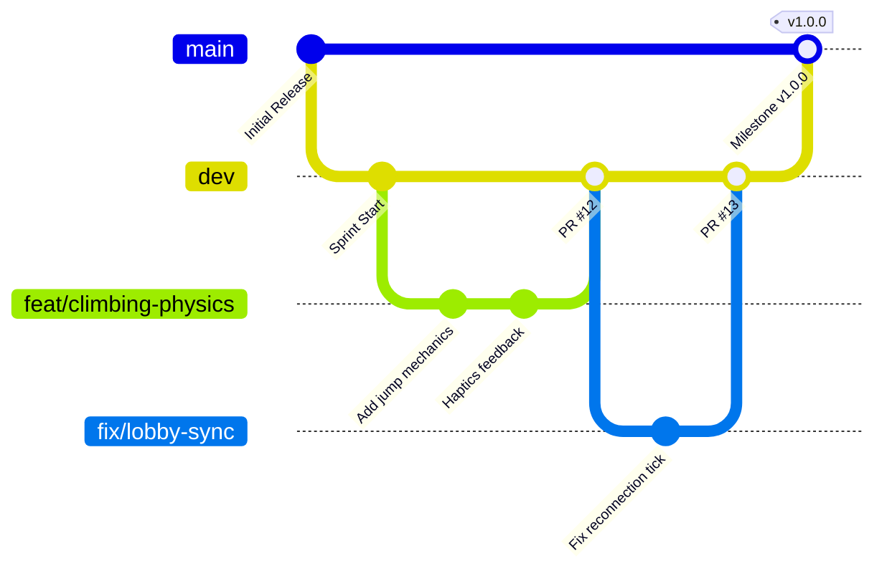

# 🧗 Way Up! - 4-Player Real-Time Mobile Game

A cross-platform real-time multiplayer vertical climbing mobile game built with **React Native (Expo SDK 58)**, a **Node.js + Express + Socket.IO** backend, and shared TypeScript contracts featuring a deterministic **Mulberry32 PRNG** engine.

---

## 🏗 Overview & Monorepo Structure

This project is organized as a TypeScript **npm workspaces** monorepo:

```text
.
├── apps/
│   ├── mobile/              # (@climb/mobile) React Native client with Expo SDK 58 & React 19
│   │   ├── src/
│   │   │   ├── components/  # Lobby, PRNG obstacle viewer, SQLite records UI
│   │   │   ├── db/          # expo-sqlite (device_identity & local_records)
│   │   │   ├── haptics/     # expo-haptics tactile feedback service
│   │   │   └── hooks/       # useMultiplayerLobby Socket.IO client hook
│   │   ├── App.tsx          # Main Expo mobile application entry
│   │   ├── app.json         # Expo project configuration (SDK 58)
│   │   └── tsconfig.json    # Strict TypeScript configuration
│   │
│   └── server/              # (@climb/server) Node.js + Express + Socket.IO server
│       ├── src/
│       │   ├── config.ts    # Server port (3001), CORS, and lobby constants
│       │   ├── index.ts     # HTTP server and WebSocket initializer (/health)
│       │   ├── rooms/       # 4-character room codes & 2–4 player lobby manager
│       │   └── socket/      # Typed Socket.IO event handlers (JOIN_ROOM, ROOM_START)
│       └── tsconfig.json    # Strict TypeScript configuration
│
├── packages/
│   └── shared/              # (@climb/shared) Shared types, PRNG, and level generation
│       ├── src/
│       │   ├── generator/   # Deterministic obstacle generator
│       │   ├── prng/        # Mulberry32 32-bit PRNG utility
│       │   ├── types/       # WebSocket payload contracts & game data models
│       │   └── index.ts     # Package barrel export
│       └── tsconfig.json    # Strict TypeScript configuration
│
├── docs/
│   └── diagrams/            # Architecture diagrams (Use Case, Sequence, ERD in .drawio)
├── .gitignore               # Comprehensive Node, Expo, OS & build outputs ignore
├── package.json             # Root monorepo workspace configuration & scripts
└── tsconfig.base.json       # Base strict TypeScript settings ("strict": true, no any)
```

### Tech Stack
* **Mobile Client (`apps/mobile`)**: React Native 0.88 with Expo SDK 58, React 19, `expo-sqlite` (WAL mode local persistence), and `expo-haptics`.
* **Backend Server (`apps/server`)**: Node.js, Express, Socket.IO 4.x with low-latency in-memory 2–4 player lobby management and 4-character room codes.
* **Shared Engine (`packages/shared`)**: Shared WebSocket event contracts and a 32-bit `Mulberry32` PRNG for synchronized obstacle generation.

---

## 📋 Prerequisites

Before setting up the project, ensure you have:
1. **Node.js**: `v20.x` or `v22.x+` (LTS recommended) and `npm` `v10+`.
2. **Expo Go App**: Installed on your physical smartphone:
   - [iOS App Store](https://apps.apple.com/app/expo-go/id982107779) (requires Expo SDK 58 build)
   - [Google Play Store](https://play.google.com/store/apps/details?id=host.exp.exponent)
3. **Free Expo Account**: Register at [expo.dev](https://expo.dev) (required for signing into Expo CLI and running Expo Go on iOS).

---

## 🚀 Getting Started (Clone & Install)

1. **Clone the repository**:
   ```bash
   git clone <REPO_URL>
   cd "Mobile Assignment"
   ```

2. **Switch to the `dev` branch**:
   ```bash
   git checkout dev
   ```

3. **Install monorepo dependencies**:
   ```bash
   npm install --legacy-peer-deps
   ```

> [!IMPORTANT]
> The `--legacy-peer-deps` flag is **required** because Expo SDK 58 uses React 19, and some community peer dependencies in npm workspaces have strict React 18 peer requirements.

---

## 🌐 Local Network Setup (Physical Device Testing)

Physical mobile devices running Expo Go cannot reach `http://localhost:3001` on your development computer. You must configure the mobile app to point to your computer's local Wi-Fi IP address.

### 1. Find Your Machine's Local IP Address
* **Windows (PowerShell / Command Prompt)**:
  ```powershell
  ipconfig
  ```
  Look for `IPv4 Address` under your active Wi-Fi adapter (e.g., `192.168.1.19`).
* **macOS / Linux (Terminal)**:
  ```bash
  ifconfig | grep "inet "
  # or
  ipconfig getifaddr en0
  ```

### 2. Configure Backend Server URL (`apps/mobile/.env`)
Copy the template [apps/mobile/.env.example](file:///c:/Users/ADMIN/Downloads/Mobile%20Assignment/apps/mobile/.env.example) to `.env` inside `apps/mobile`:

```bash
# On Windows (PowerShell)
Copy-Item apps/mobile/.env.example apps/mobile/.env

# On macOS / Linux
cp apps/mobile/.env.example apps/mobile/.env
```

Open [apps/mobile/.env](file:///c:/Users/ADMIN/Downloads/Mobile%20Assignment/apps/mobile/.env) and replace `<YOUR_LAN_IP>` with your computer's local Wi-Fi IP address:

```env
EXPO_PUBLIC_SERVER_URL=http://<YOUR_LAN_IP>:3001
```

> [!NOTE]
> `apps/mobile/App.tsx` reads `process.env.EXPO_PUBLIC_SERVER_URL ?? 'http://localhost:3001'`. Whenever you modify `apps/mobile/.env`, restart Expo with cache cleared (`npx expo start -c`) so Metro loads the updated environment variable without editing any source files.

### 3. Wi-Fi & Firewall Troubleshooting
* **Same Wi-Fi Network**: Ensure your laptop and phone are connected to the exact same Wi-Fi router (disable VPNs and cellular data fallback).
* **Verify Connectivity**: Open your phone's browser and navigate to:
  ```text
  http://<YOUR_LOCAL_IP>:3001/health
  ```
  It should return `{"status":"ok", ...}`.
* **Windows Firewall**: If your phone cannot load the URL or the app stays stuck on `CONNECTING`:
  1. Open **Windows Defender Firewall with Advanced Security**.
  2. Create a new **Inbound Rule** for **Port** > **TCP** > `3001` > **Allow the connection**.
  3. Alternatively, in PowerShell (Administrator):
     ```powershell
     New-NetFirewallRule -DisplayName "Climb Server (Port 3001)" -Direction Inbound -LocalPort 3001 -Protocol TCP -Action Allow
     ```

---

## 🎮 Running the Project

Open two separate terminals:

### Quick Start (two terminals, from the project root)

```bash
# Terminal 1: game server on port 3001
npm run dev:server

# Terminal 2: Expo for a physical phone (replace with your LAN IP: `ipconfig getifaddr en0` on macOS)
cd apps/mobile
EXPO_PUBLIC_SERVER_URL=http://<YOUR_LAN_IP>:3001 npx expo start --lan
```

Then open Expo Go on a phone on the same Wi-Fi and scan the QR code (or enter `exp://<YOUR_LAN_IP>:8081`). Passing `EXPO_PUBLIC_SERVER_URL` inline works without a `.env` file; the detailed steps below use `.env` instead.

### Terminal 1: Backend WebSocket Server
From the project root:
```bash
npm run dev:server
```
* Runs with `tsx watch` on port `3001`.
* Production-style run (compiled JS on plain Node):
  ```bash
  npm run build
  npm start --workspace=@climb/server
  ```
* Health check: [http://localhost:3001/health](http://localhost:3001/health)
* Active rooms monitor: [http://localhost:3001/api/rooms](http://localhost:3001/api/rooms)

### Terminal 2: Mobile App (Expo Metro)
1. Navigate into the mobile directory:
   ```bash
   cd apps/mobile
   ```
2. Sign in to your Expo account (make sure to log into the same account inside Expo Go on iOS):
   ```bash
   npx expo login
   ```
3. Start the Metro bundler with cache cleared:
   ```bash
   npx expo start -c
   ```
4. **Scan QR Code**:
   - **Android**: Scan directly inside the Expo Go app.
   - **iOS**: Scan using the default Camera app (opens in Expo Go).

---

## ✅ Verification

Run the root type-check command to verify that all three packages pass TypeScript checks with zero errors:

```bash
npm run typecheck
```

This sequentially executes `tsc --noEmit` across `@climb/shared`, `@climb/server`, and `@climb/mobile`.

---

## 🌿 Git Branching Workflow

We adhere to a standard Git flow:



* **`main`**: Protected branch reserved strictly for stable milestone releases and final submissions.
* **`dev`**: Active integration branch where all tested features land.
* **Feature Branches**:
  1. Branch off `dev`:
     ```bash
     git checkout dev
     git pull origin dev
     git checkout -b feat/your-feature-name
     ```
  2. Implement changes and verify:
     ```bash
     npm run typecheck
     ```
  3. Commit using conventional commits (e.g. `feat: ...`, `fix: ...`, `chore: ...`).
  4. Open a Pull Request targeting `dev` for team review.

---

## 📜 Monorepo Scripts Reference

| Command | Workspace | Description |
| :--- | :--- | :--- |
| `npm run dev:server` | Root | Shortcut for `npm run dev --workspace=@climb/server`: backend with live-reloading (`tsx watch`). |
| `npm run dev:mobile` | Root | Shortcut for `npm run start --workspace=@climb/mobile`: starts Expo Metro (server URL defaults to `localhost:3001`). |
| `npm run build` | Root | Compiles `@climb/shared` and `@climb/server` to `dist/`. |
| `npm start --workspace=@climb/server` | `apps/server` | Runs the compiled server (`node dist/index.js`); run `npm run build` first. |
| `npm run typecheck` | All | Runs `tsc --noEmit` across all 3 workspaces. |
| `npm run clean` | Root | Purges build caches and compiled dist folders. |

---

## 📡 WebSocket Event Contracts

| Event | Direction | Payload Summary | Purpose |
| :--- | :--- | :--- | :--- |
| `JOIN_ROOM` | Client ➔ Server | `{ roomCode?, playerName, playerId }` | Create or join a 4-char room code. |
| `SET_READY` | Client ➔ Server | `{ roomCode, playerId, isReady }` | Toggle readiness in lobby. |
| `ROOM_START` | Client ➔ Server | `{ roomCode, playerId }` | Host triggers match start. |
| `ROOM_JOINED` | Server ➔ Client | `{ room, selfPlayerId, assignedColor }` | Confirms room membership & slot color. |
| `ROOM_UPDATED` | Server ➔ Client | `{ room, changeReason }` | Broadcasts roster & readiness updates. |
| `ROOM_START` | Server ➔ Client | `{ roomCode, seed, countdownDurationMs, climbGoalHeight }` | Broadcasts 32-bit PRNG seed & countdown. |
| `GAME_TICK` | Server ➔ Client | `{ tick, timestamp, players }` | Synchronized climbing coordinates. |

---

## 🗄 SQLite Database Schema (`apps/mobile`)

Local persistence managed via `expo-sqlite`:

```sql
-- Guest identity persistent authentication
CREATE TABLE IF NOT EXISTS device_identity (
  id TEXT PRIMARY KEY NOT NULL,
  guest_uuid TEXT NOT NULL UNIQUE,
  nickname TEXT NOT NULL,
  created_at INTEGER NOT NULL,
  last_active_at INTEGER NOT NULL
);

-- Offline gameplay scores and records
CREATE TABLE IF NOT EXISTS local_records (
  id TEXT PRIMARY KEY NOT NULL,
  player_id TEXT NOT NULL,
  score INTEGER NOT NULL,
  height REAL NOT NULL,
  seed INTEGER NOT NULL,
  duration_ms INTEGER NOT NULL,
  recorded_at INTEGER NOT NULL,
  sync_status TEXT NOT NULL
);

CREATE INDEX IF NOT EXISTS idx_records_score ON local_records(score DESC);
CREATE INDEX IF NOT EXISTS idx_records_sync ON local_records(sync_status);
```

---

## 📄 License

UNLICENSED (Proprietary - Assignment Submission)
